

# خوش‌آمدگویی اسلایسر

سونیا پوجول، دکترا

استادیار رادیولوژی

بیمارستان بریگام و زنان

دانشکده پزشکی هاروارد

---

## هدف

این آموزش مقدمه‌ای کوتاه بر ماژول Welcome نرم‌افزار متن‌باز Slicer است.

---

## مبانی Slicer5

*Slicer یک نرم‌افزار متن‌باز برای بخش‌بندی، هم‌ترازی و تصویرسازی داده‌های تصویربرداری پزشکی است.

*این پلتفرم از طریق تلاش مشترک چندین کنسرسیوم بزرگ با حمایت مالی NIH و با مشارکت چندین مؤسسه توسعه یافته است.

*Slicer فقط برای تحقیقات پزشکی است و مورد تأیید FDA نیست. 

---

## مبانی Slicer5

نسخهٔ ۵.۱۰.۰ نرم‌افزار ۳D Slicer شامل بیش از ۱۰۰ ماژول و بیش از ۱۹۰ افزونه برای بخش‌بندی تصویر، هم‌ترازی و تصویرسازی سه‌بعدی داده‌های تصویربرداری پزشکی است.

---

## پلتفرم‌های پشتیبانی‌شده

*Slicer یک نرم‌افزار چند سکویی است که بر روی مک او‌اس‌اکس، لینوکس و ویندوز توسعه یافته و نگهداری می‌شود.

*Slicer به حداقل ۲ گیگابایت رم و یک شتاب‌دهنده گرافیکی اختصاصی با ۶۴ مگابایت حافظه گرافیکی داخلی نیاز دارد. 

---

## به اسلایسر خوش آمدید

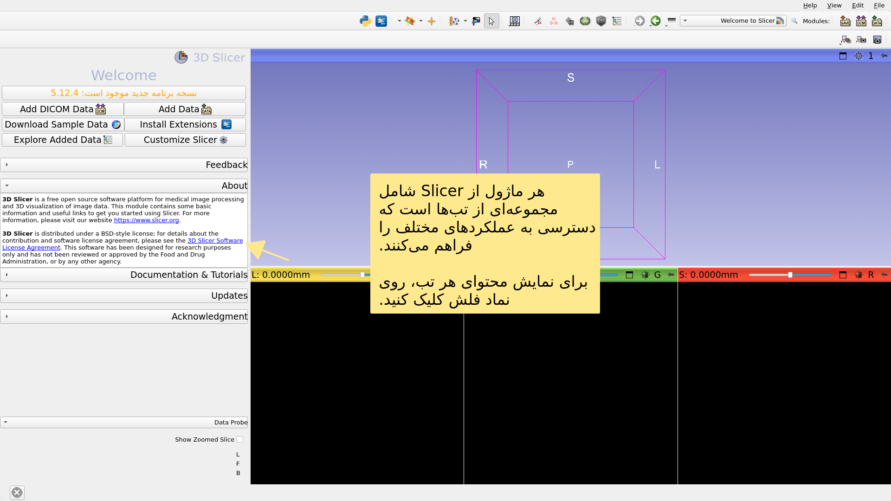

---

## رابط کاربری اسلایسر

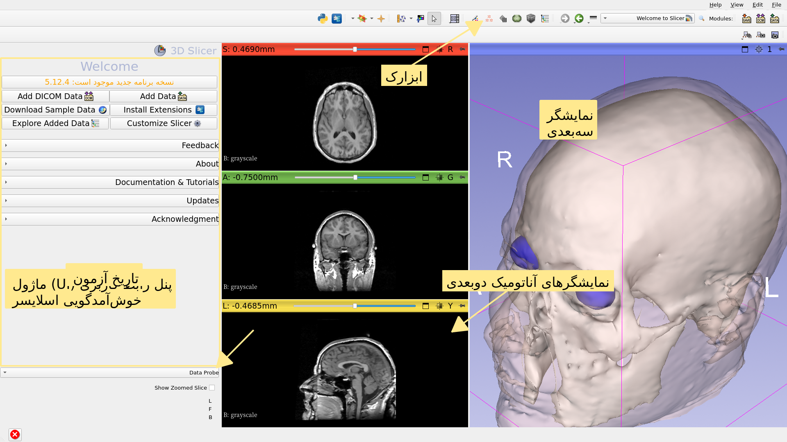

---

## ماژول خوش‌آمدگویی

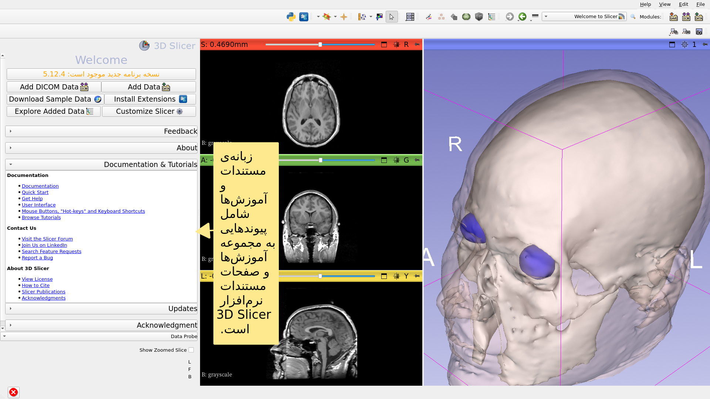

---

## ماژول خوش‌آمدگویی

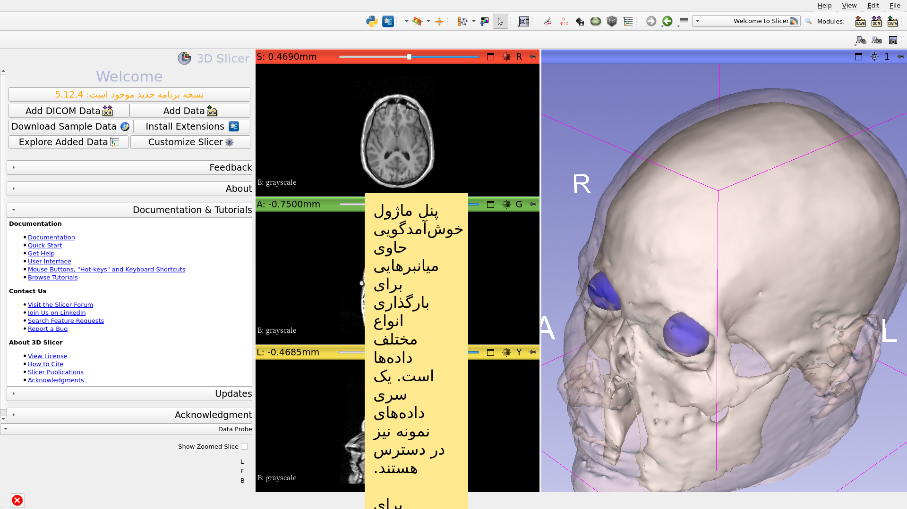

---

## داده‌های نمونه

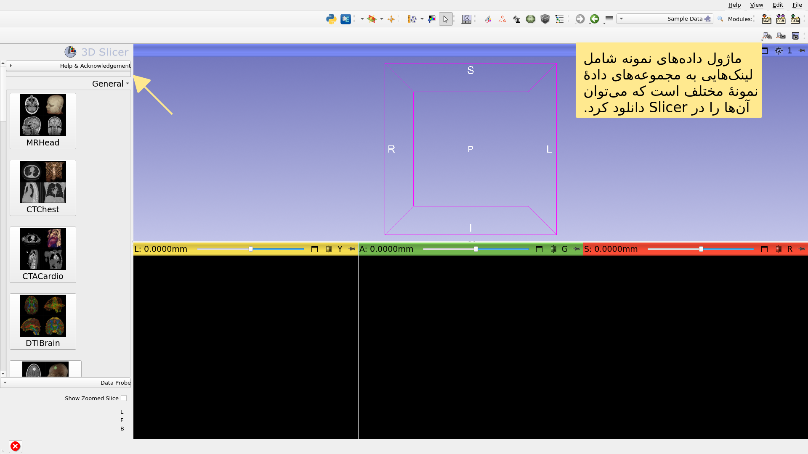

---

## داده‌های نمونه

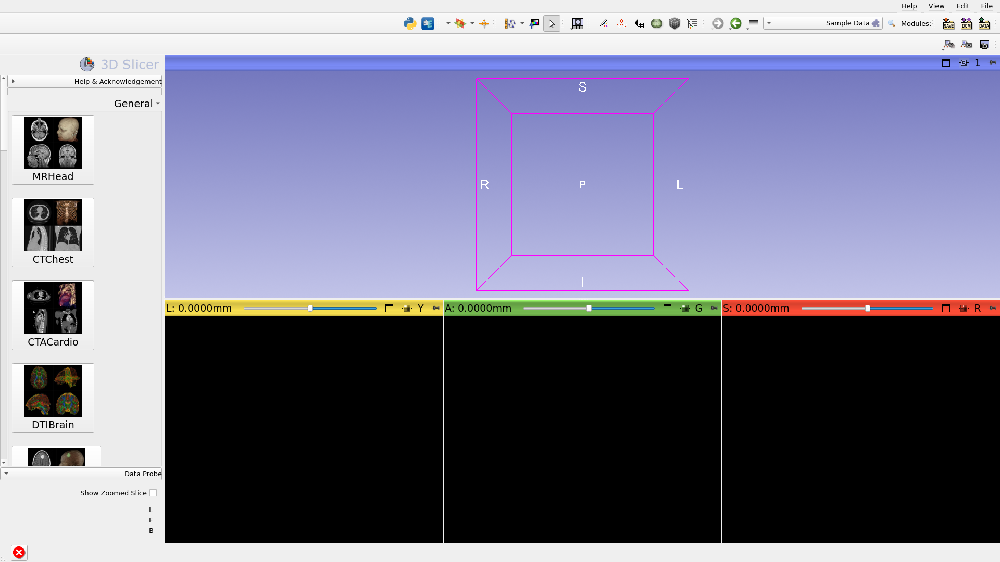

---

## داده‌های نمونه

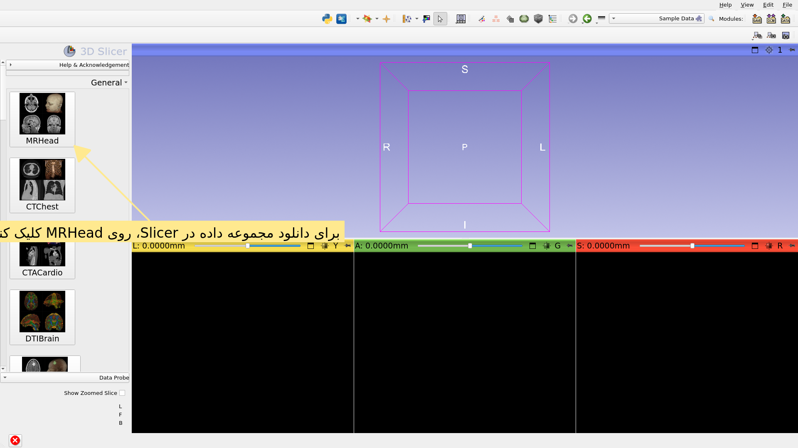

---

## ماژول خوش‌آمدگویی

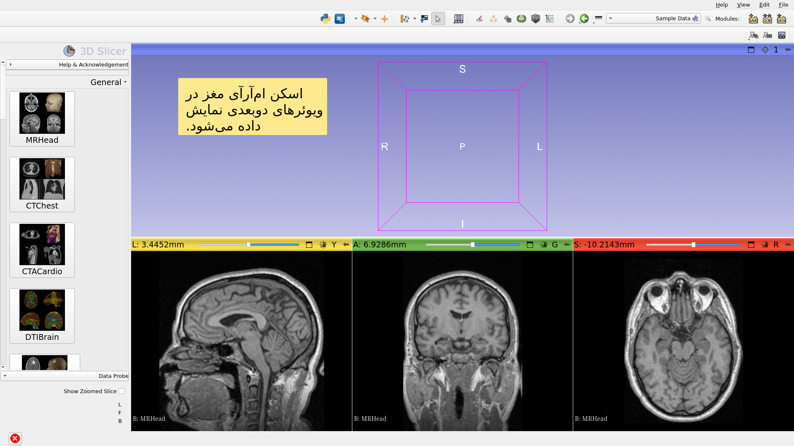

---

## مجموعه داده‌های نمونه مغز ام‌آرآی

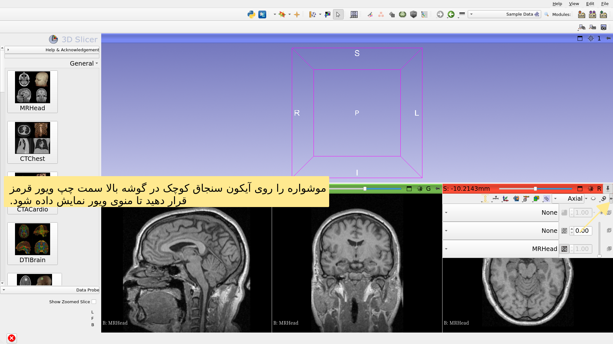

---

## مجموعه داده‌های نمونه مغز ام‌آرآی

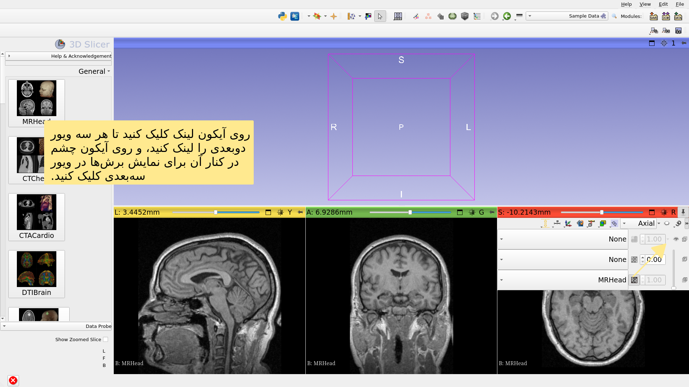

---

## مجموعه داده‌های نمونه مغز ام‌آرآی

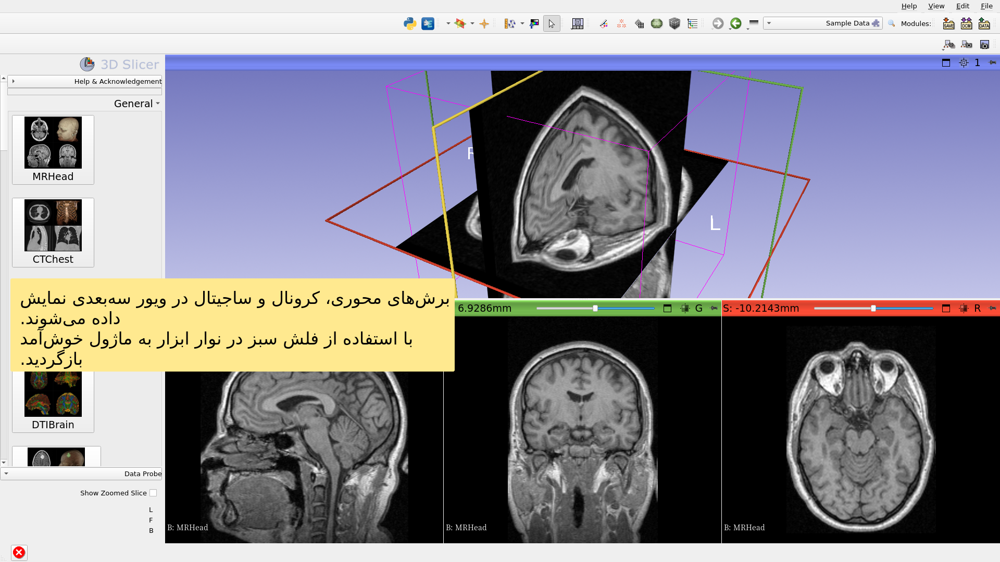

---

## گام فراتر

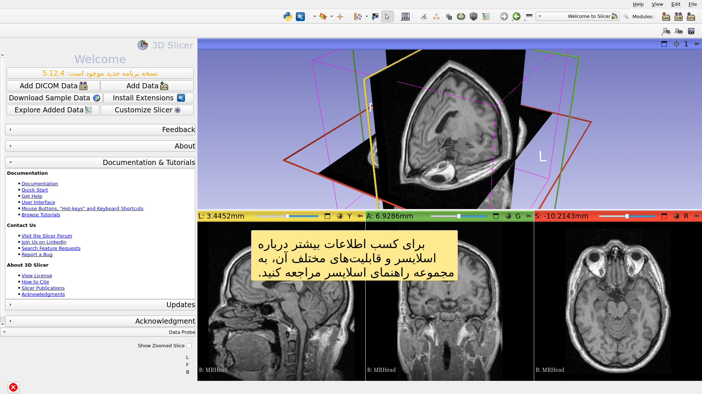

---

## گام فراتر

https://training.slicer.org/

---

# تشکر و قدردانی

ائتلاف ملی برای رایانش تصویر پزشکی

NIH U54EB005149

مرکز تحلیل نورویمج

NIH P41EB015902

ابتکار چان و زاکربرگ (CZI)

---
