

# اسلایسر ۴ دقیقه

سونیا پوجول، دکترا

 

استادیار رادیولوژی
بیمارستان بریگهام و زنان
دانشکده پزشکی هاروارد

---

## آموزش ۴ دقیقه‌ای اسلایسر

این آموزش، مقدمه‌ای چهار دقیقه‌ای بر قابلیت‌های بصری‌سازی سه‌بعدی نرم‌افزار Slicer5 برای تحلیل تصاویر پزشکی است. 

---

## نرم‌افزار Slicer5 و مجموعه داده‌ها

*نرم‌افزار Slicer5 را از http://download.slicer.org دانلود کنید.

*مجموعه داده Slicer4minute را از https://www.slicer.org/wiki/Documentation/4.10/Training دانلود کنید.

---

## 3D Slicer نسخهٔ ۵

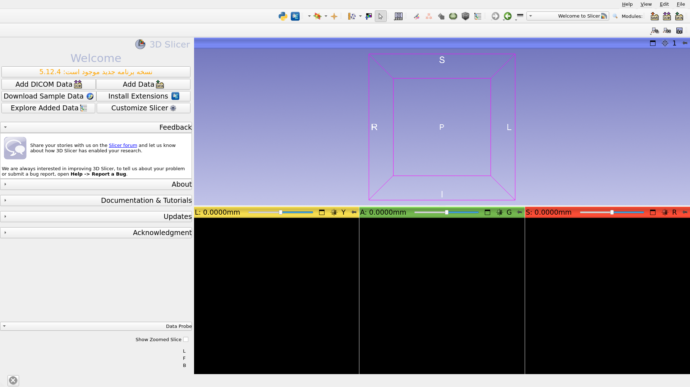

---

## صحنه اسلایسر سه‌بعدی

یک صحنه Slicer یک فایل MRML (زبان مدل‌سازی واقعیت پزشکی) است که شامل فهرستی از عناصر بارگذاری‌شده در Slicer (حجم‌ها، مدل‌ها، نشانگرها، تبدیل‌ها و غیره) می‌باشد.

*در مثال زیر، ما از صحنه‌ای به نام «Slicer4minute.mrml» استفاده می‌کنیم که شامل یک اسکن MRI و مدل‌های سه‌بعدی سر است. 

*فایل صحنه و مجموعه‌های داده به صورت یک فایل MRB (Medical Reality Bundle) ذخیره شده‌اند. 

*فرمت فایل MRB، فرمت آرشیو Slicer است.

---

## بارگذاری مجموعه دادهٔ Slicer4minute

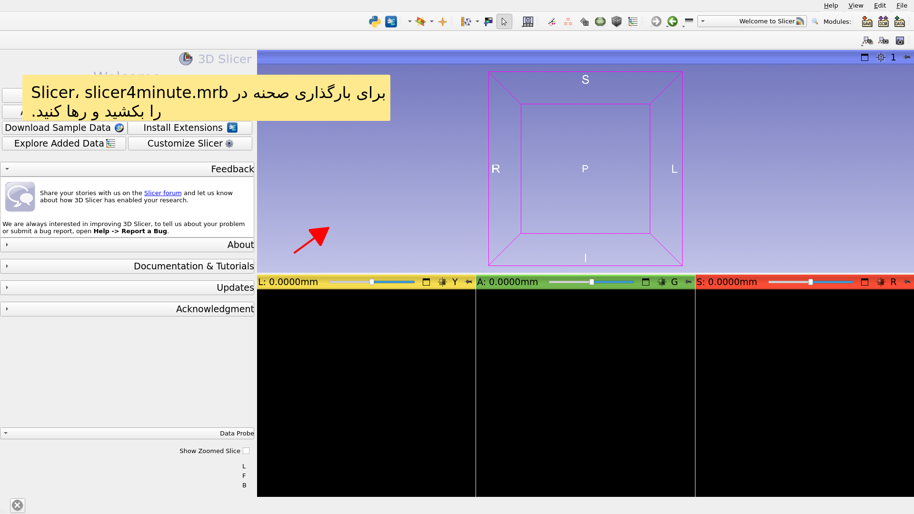

---

## صحنه‌ی Slicer4minute

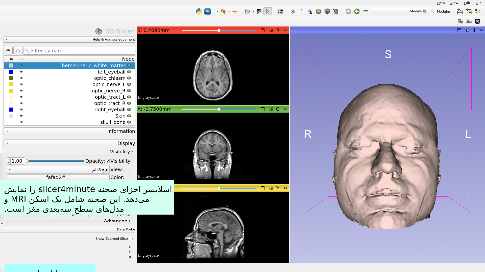

---

## رندر سه‌بعدی

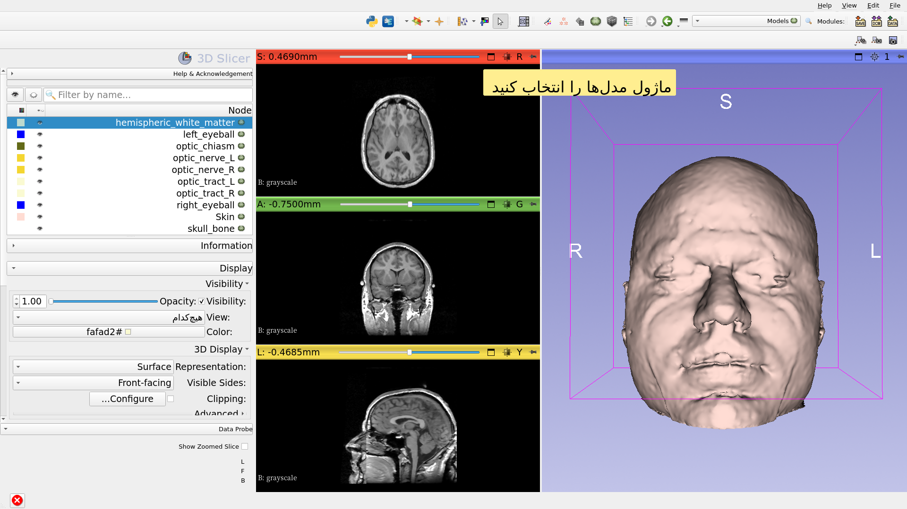

---

## مجازی‌سازی سه‌بعدی

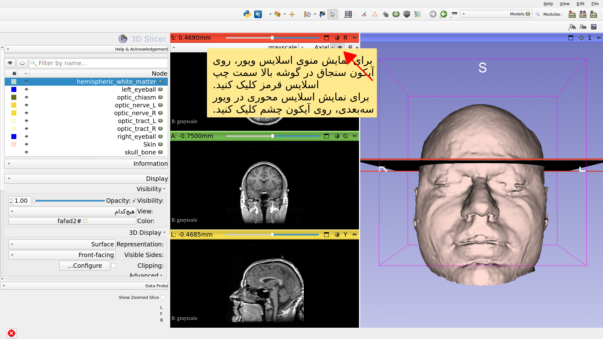

---

## رندر سه‌بعدی

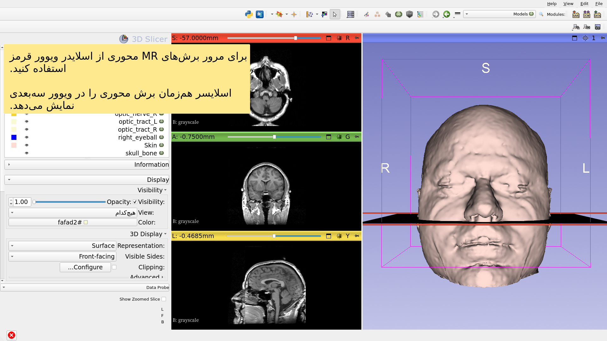

---

## رندر سه‌بعدی

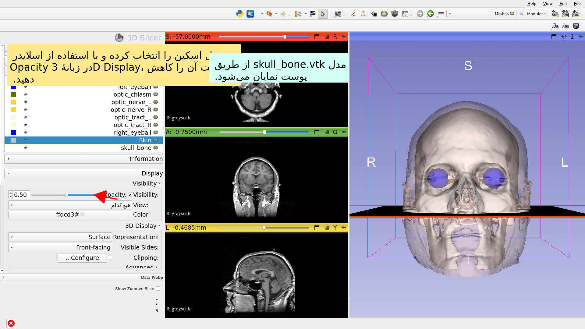

---

## رندر سه‌بعدی

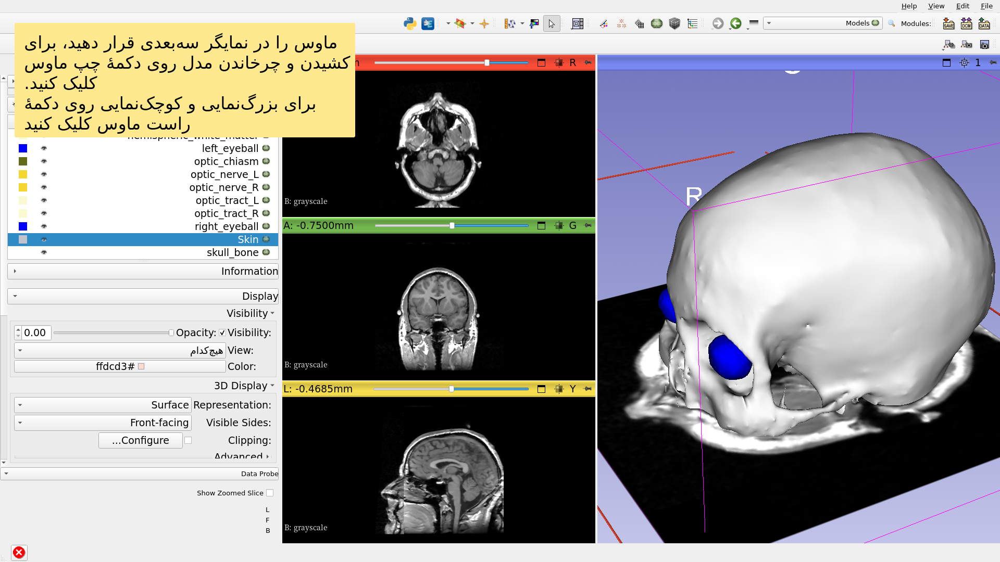

---

## دیدهای آناتومیک

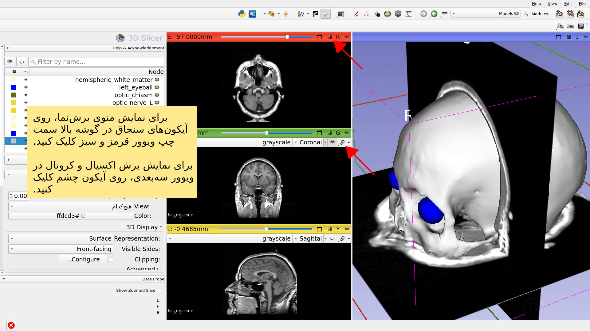

---

## رندر سه‌بعدی

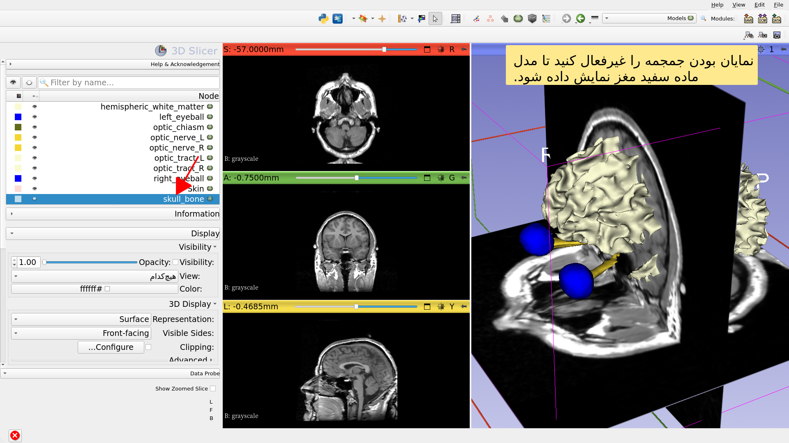

---

## رندر سه‌بعدی

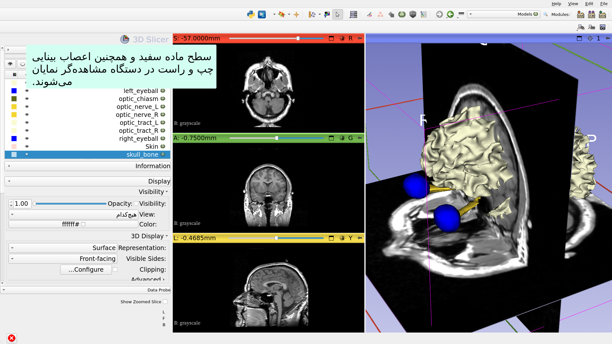

---

## رندر سه‌بعدی

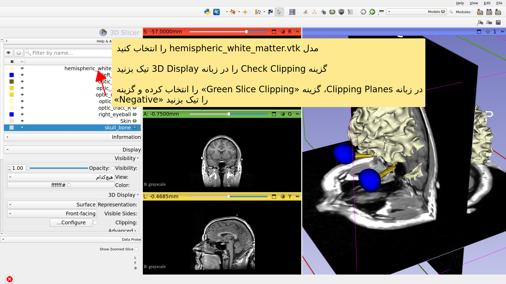

---

## آموزش ۴ دقیقه‌ای اسلایسر

*این آموزش، مقدمه‌ای کوتاه بر بصری‌سازی سه‌بعدی تعاملی داده‌های MRI و مدل‌های سه‌بعدی در Slicer بود.

*مجموعه آموزشی Slicer5 حاوی مجموعه‌ای از آموزش‌ها و مجموعه‌داده‌های از پیش محاسبه شده برای یادگیری نحوه استفاده از این نرم‌افزار است.

---

# تشکر و قدردانی

اتحادیه ملی تصویربرداری محاسباتی پزشکی

NIH U54EB005149

مرکز تحلیل نورویمج

NIH P41EB015902

---
