

# AI-based Segmentation in 3D Slicer

سونیا پوجول، دکترای فلسفه
بیمارستان بریگهام و زنان
دانشکده پزشکی هاروارد
بوستون، ماساچوست

 

کارگاه اسلایسر ریبیراو پرتو
۳۰ ژوئن ۲۰۲۵

---

## بخش‌بندی دستی در مقابل بخش‌بندی مبتنی بر هوش مصنوعی

تصاویر پزشکی به‌طور سنتی به‌صورت دستی بخش‌بندی شده‌اند، که فرآیندی وقت‌گیر است، نیازمند تلاش فراوان رادیولوژیست‌ها بوده و تحت تأثیر تغییرپذیری بین خوانندگان قرار دارد.

---

## بخش‌بندی دستی در مقابل بخش‌بندی مبتنی بر هوش مصنوعی

در دهه گذشته، بخش‌بندی تصویر با توسعه الگوریتم‌های یادگیری عمیق (مانند nnUnet توسط مرکز تحقیقات سرطان آلمان (DKFZ)/پژوهش هلمولتز) قدرتمند شده است.

ابزارهای بخش‌بندی مبتنی بر هوش مصنوعی می‌توانند زمان بخش‌بندی را کاهش داده و نتایج قابل بازتولید بیشتری ارائه دهند.

---

## اصطلاحات هوش مصنوعی

مدل، یک الگوریتم هوش مصنوعی است که برای انجام یک وظیفه خاص آموزش دیده است (مانند مدل بخش‌بندی تومور مغزی).

ضرایب یک مدل هوش مصنوعی، اعداد کوچکی هستند که تعیین می‌کنند مدل چقدر اهمیت به ویژگی‌های مختلف تصویر می‌دهد.

در طول فاز آموزش، یک مدل الگوها را از داده‌هایی که توسط متخصصان برچسب‌گذاری شده‌اند، یاد می‌گیرد و وزن‌های خود را برای بهبود پیش‌بینی‌هایش تنظیم می‌کند.

در طول فاز اعتبارسنجی/آزمون، مدل بر روی یک مجموعه داده جداگانه که در فاز آموزش استفاده نشده است، ارزیابی می‌شود.

در طول استنتاج، مدل بر روی مجموعه‌های داده جدید اعمال می‌شود تا وظیفه خاصی را که برای آن آموزش دیده است، انجام دهد.

---

## آموزش هوش مصنوعی ۳دی اسلایسر

این آموزش بر اجرای وظایف استنتاج با استفاده از مدل‌های هوش مصنوعی از پیش آموزش‌دیدهٔ گوناگون برای بخش‌بندی خودکار ساختارهای آناتومیک و پاتولوژیک تمرکز دارد.

---

## افزونه برش‌زن بخش‌های سه‌بعدی MONAIAuto

این آموزش از مدل‌های از پیش آموزش‌دیدهٔ افزونهٔ MONAIAuto3DSeg Slicer استفاده می‌کند.

این ابزار برای کار بر روی لپ‌تاپ‌ها یا رایانه‌های رومیزی متوسط بدون GPU طراحی شده است.

---

## افزونه برش‌زن بخش‌های سه‌بعدی MONAIAuto

پشتیبانی از مدالیته های متعدد (سی‌تی، ام‌آر‌آی).

پشتیبانی از آناتومی‌های متعدد (سر، قفسه سینه، شکم، لگن، و غیره).

پشتیبانی از پاتولوژی‌های متعدد (تومور، خونریزی، ادم).

---

## آموزش هوش مصنوعی Slicer: وظایف بخش‌بندی

وظیفهٔ بخش‌بندی شمارهٔ ۱: پروستات

وظیفهٔ بخش‌بندی شمارهٔ ۲: گلیوم مغز

وظیفهٔ بخش‌بندی شمارهٔ ۳: بخش‌بندی کل بدن

---

# وظیفهٔ بخش‌بندی هوش مصنوعی شمارهٔ ۱: پروستات

---

##  

بخش‌بندی مبتنی بر هوش مصنوعی ناحیه پیرامونی (PZ) و ناحیه انتقالی (TZ) پروستات در تصاویر MRI با وزن‌دهی T2.

مجموعه داده:

msd_prostate_01-t2

msd_prostate_01-adc

---

## 

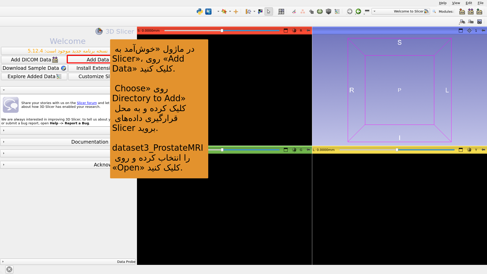

---

## 

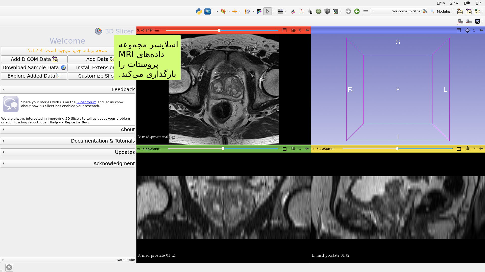

---

## 

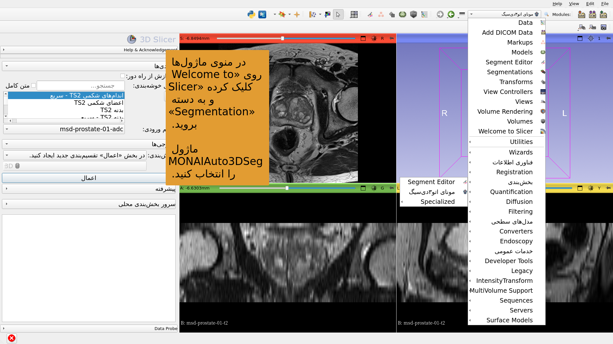

---

## 

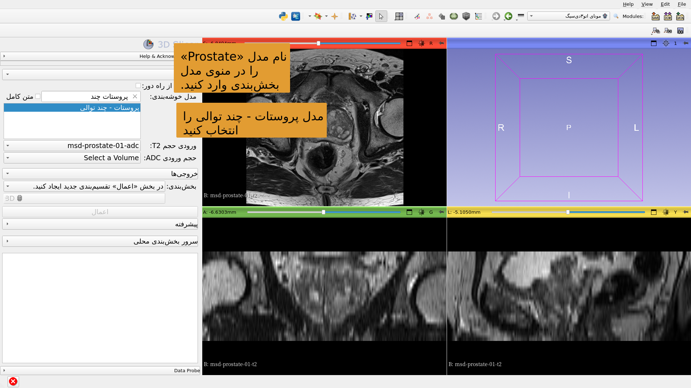

---

## 

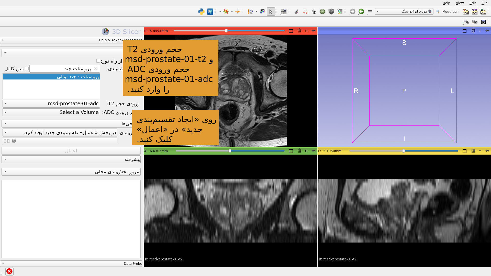

---

## 

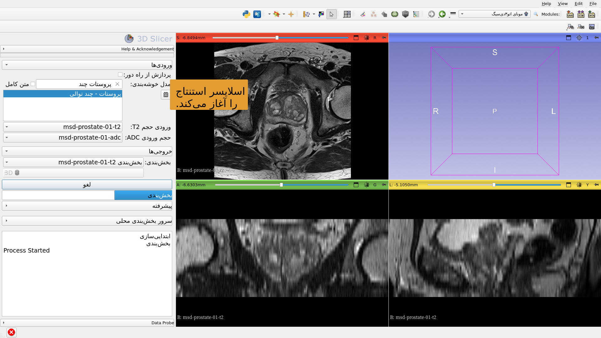

---

## 

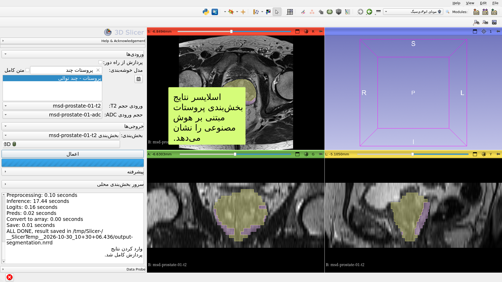

---

# وظیفهٔ بخش‌بندی هوش مصنوعی شمارهٔ ۲: گلیوم مغز

---

##  

بخش‌بندی مبتنی بر هوش مصنوعی نئوپلاسم، نکروز و ادم در تصاویر ام‌آر‌آی مغز.

مجموعه‌های داده:

۱) BraTS-GLI_00005-000-t1n (وزن‌دهی T1)

۲) BraTS-GLI_00005-000-t1c (وزن‌دهی T1 پس از گادولینیم)

۳) BraTS-GLI_00005-000-t2w (وزن‌دهی T2)

۴) BraTS-GLI_00005-000-t2f (T2-FLAIR)

---

## 

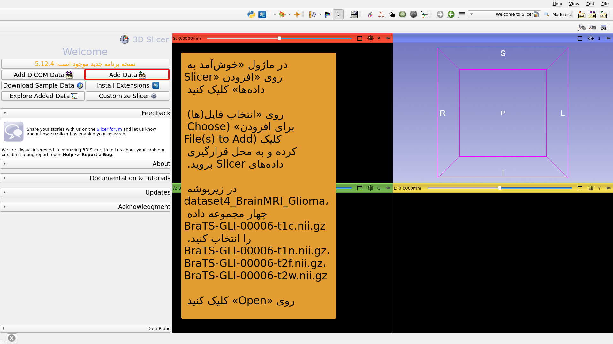

---

## 

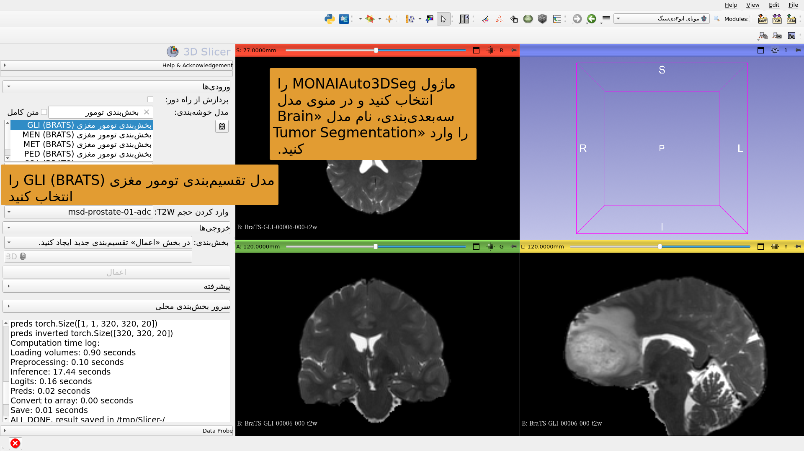

---

## 

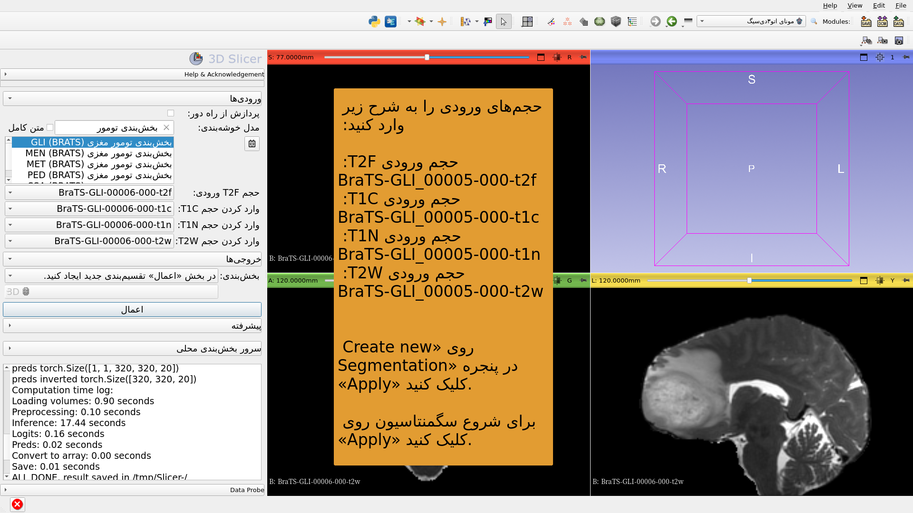

---

## 

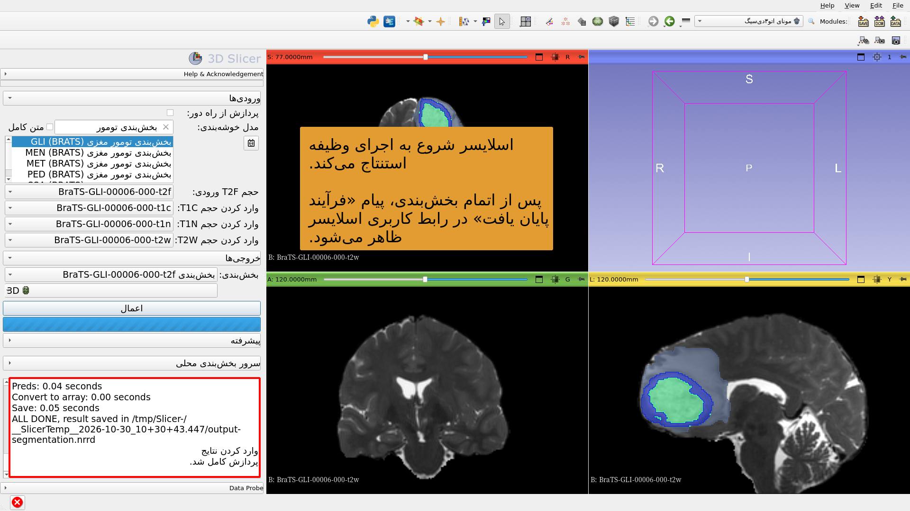

---

## 

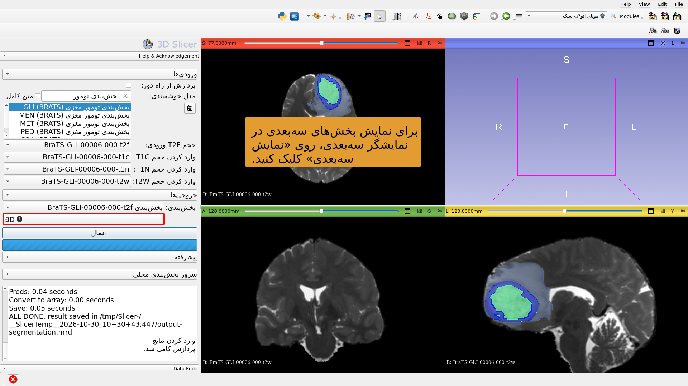

---

# وظیفهٔ ۳ بخش‌بندی هوش مصنوعی: بخش‌بندی کل بدن

---

##  

بخش‌بندی کل بدن مبتنی بر هوش مصنوعی.

مجموعه داده:

CT_ThoraxAbdomen

---

## 

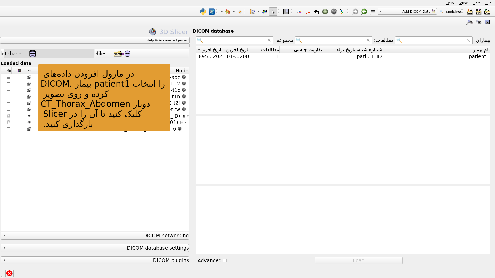

---

## 

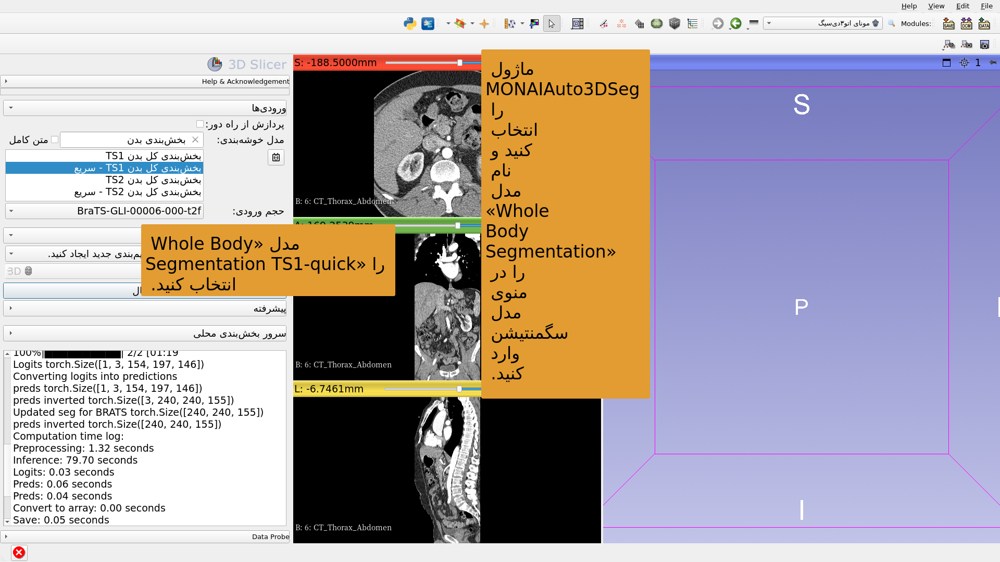

---

## 

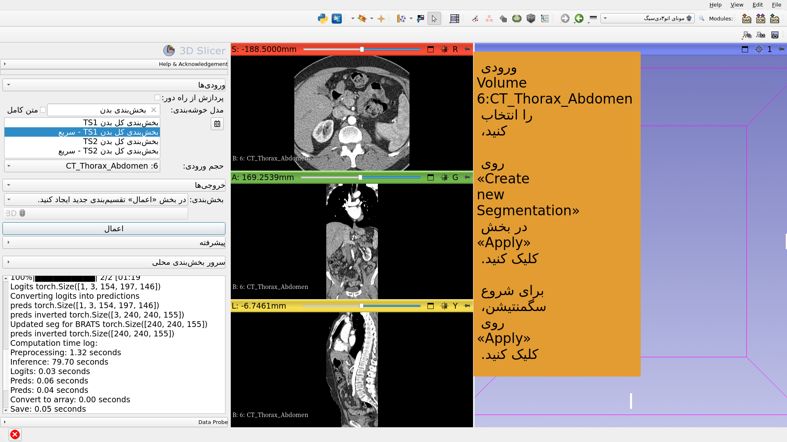

---

## 

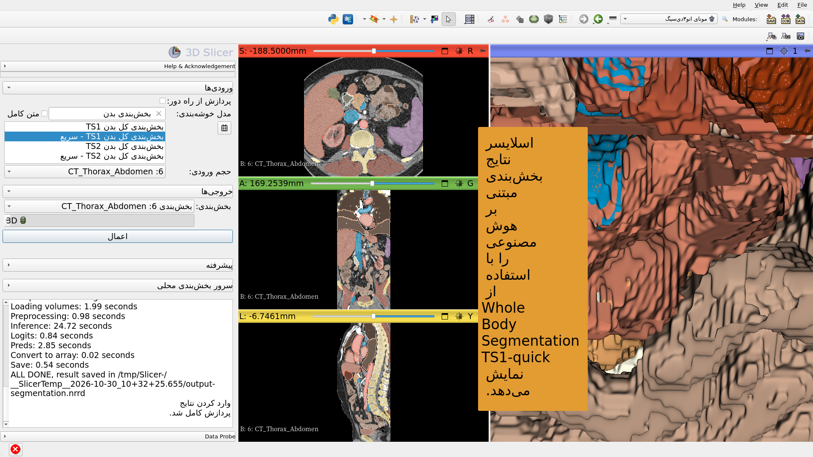

---

## نتیجه‌گیری

افزونه MONAIAuto3DSeg نرم‌افزار 3D Slicer، بخش‌بندی سریع مبتنی بر هوش مصنوعی از ساختارهای آناتومیک و پاتولوژیک را فراهم می‌کند.

این ماژول می‌تواند بر روی کامپیوترهای استاندارد لپ‌تاپ و دسکتاپ بدون GPU اجرا شود.

---

# تشکر و قدردانی

پروژه بین‌المللی‌سازی 3D Slicer و پروژه 3D Slicer برای آمریکای لاتین با حمایت مالی ابتکار چان و زوکربرگ امکان‌پذیر شده‌اند.

---
