

# 在 3D Slicer 中使用 AI 分割

Sonia Pujol 博士
布里格姆妇女医院
哈佛医学院
美国马萨诸塞州波士顿

 

Slicer 里贝朗普雷图研讨班
2025 年 6 月 30 日

---

## 手工分割与 AI 分割

医学影像传统上由人工分割。这一过程耗时，需要放射科医师投入大量精力，结果也会因阅片者而异。

---

## 手工分割与 AI 分割

过去十年，深度学习算法推动了影像分割的发展，例如德国癌症研究中心（DKFZ）及亥姆霍兹研究机构开发的 nnU-Net。

AI 分割工具可缩短分割时间，提高结果的可重复性。

---

## AI 术语

模型是经过训练、可执行特定任务的 AI 算法，例如脑肿瘤分割模型。

权重是模型中的数值参数，决定模型赋予不同影像特征的重要程度。

训练阶段，模型从专家标注的数据中学习规律，并调整权重以改善预测。

验证和测试阶段，使用训练时未用过的独立数据评估模型。

推理阶段，将模型应用于新数据集，执行训练所针对的任务。

---

## 3D Slicer AI 教程

本教程介绍如何使用不同的预训练 AI 模型进行推理，自动分割解剖结构和病变。

---

## Slicer 扩展 MONAIAuto3DSeg

本教程使用 Slicer 扩展 MONAIAuto3DSeg 的预训练模型。

该工具可在没有 GPU 的笔记本电脑或普通台式机上运行。

---

## Slicer 扩展 MONAIAuto3DSeg

支持多种成像模态（CT、MRI）。

覆盖多个解剖部位（头部、胸部、腹部、盆腔等）。

支持多种病变（肿瘤、出血、水肿）。

---

## Slicer AI 教程的分割任务

分割任务 1：前列腺

分割任务 2：脑胶质瘤

分割任务 3：全身分割

---

# AI 分割任务 1：前列腺

---

##  

在 T2 加权 MRI 图像上使用 AI 分割前列腺外周带（PZ）和移行带（TZ）。

数据集：

msd_prostate_01-t2

msd_prostate_01-adc

---

## 

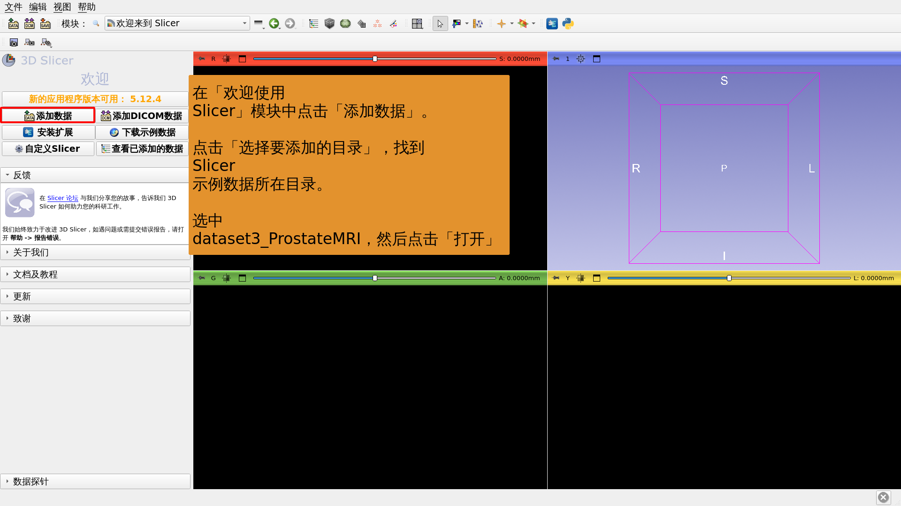

---

## 

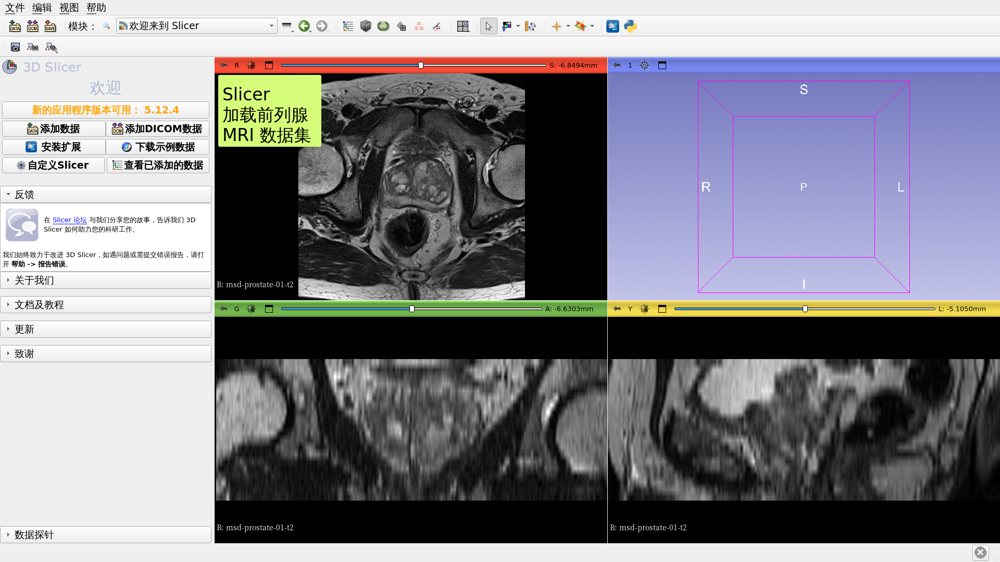

---

## 

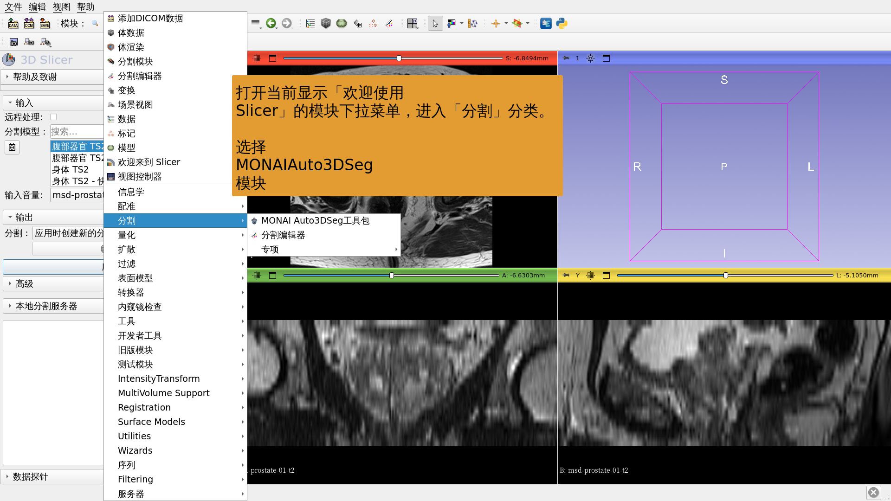

---

## 

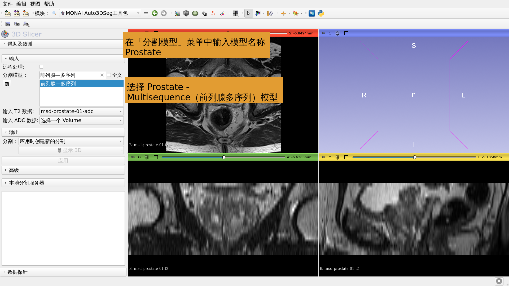

---

## 

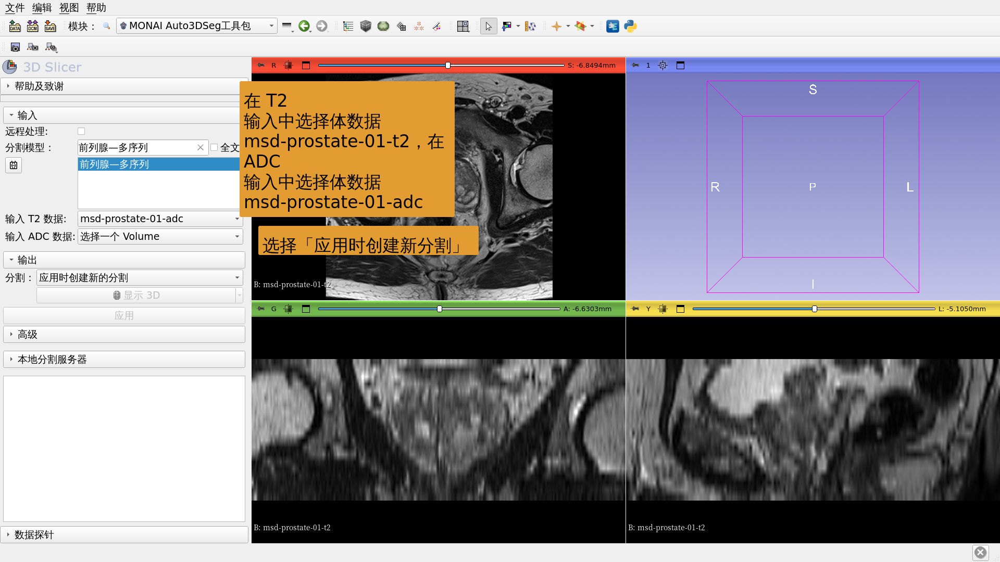

---

## 

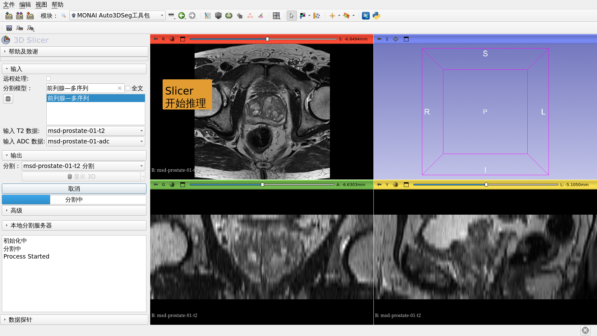

---

## 

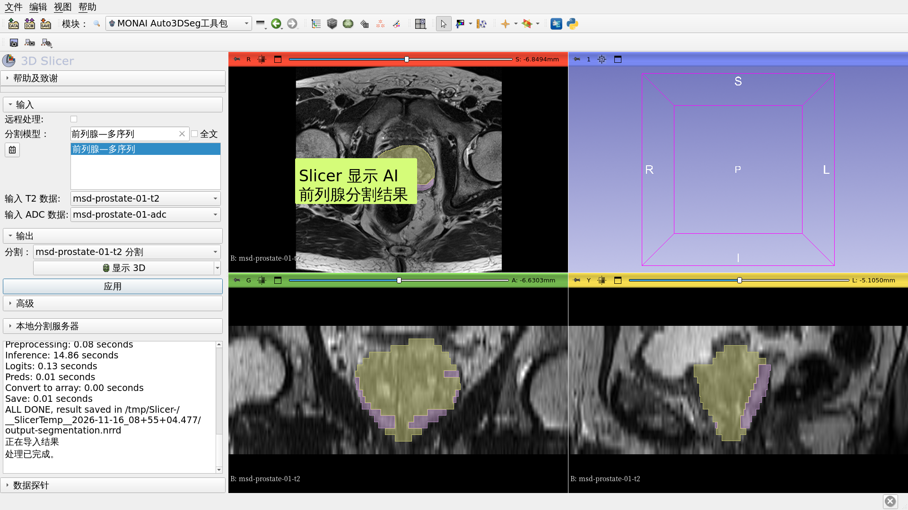

---

# AI 分割任务 2：脑胶质瘤

---

##  

使用 AI 在脑部 MRI 图像中分割肿瘤、坏死和水肿区域。

数据集：

1）BraTS-GLI_00005-000-t1n（T1 加权）

2）BraTS-GLI_00005-000-t1c（钆增强后 T1 加权）

3）BraTS-GLI_00005-000-t2w（T2 加权）

4）BraTS-GLI_00005-000-t2f（T2-FLAIR）

---

## 

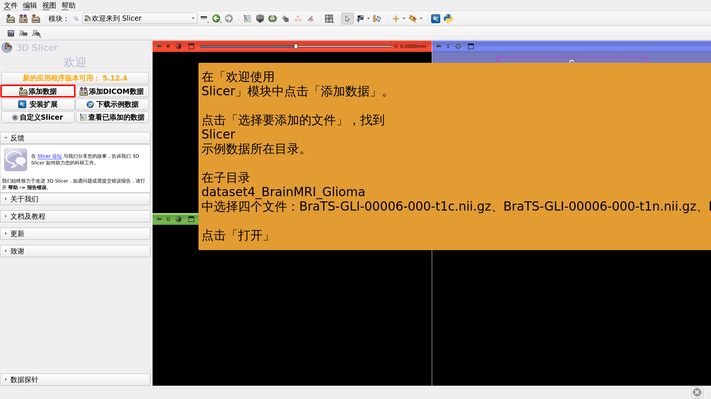

---

## 

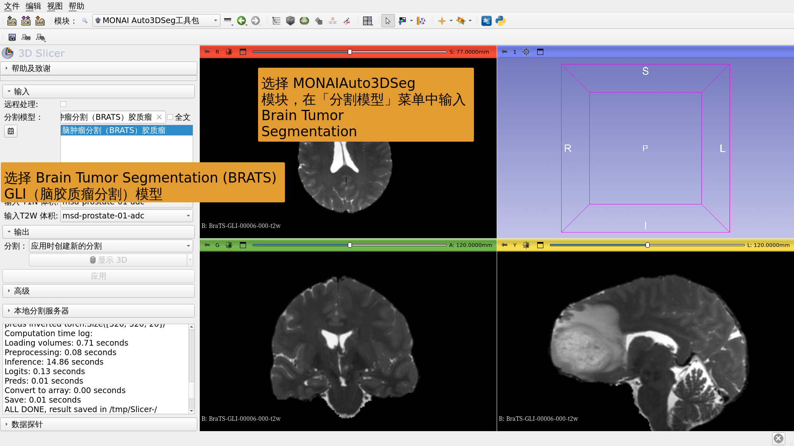

---

## 

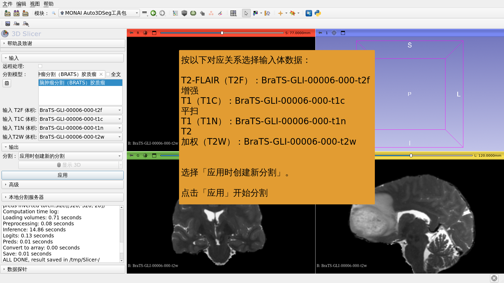

---

## 

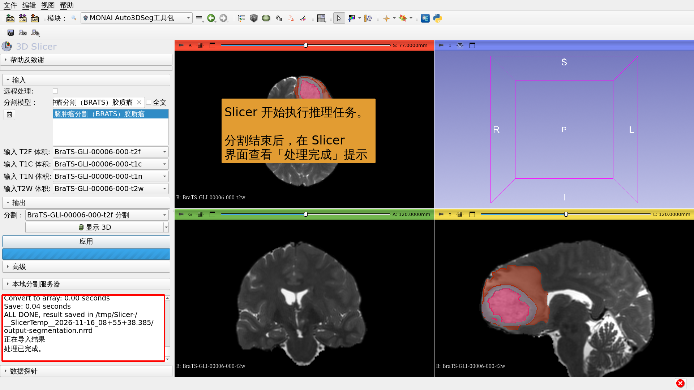

---

## 

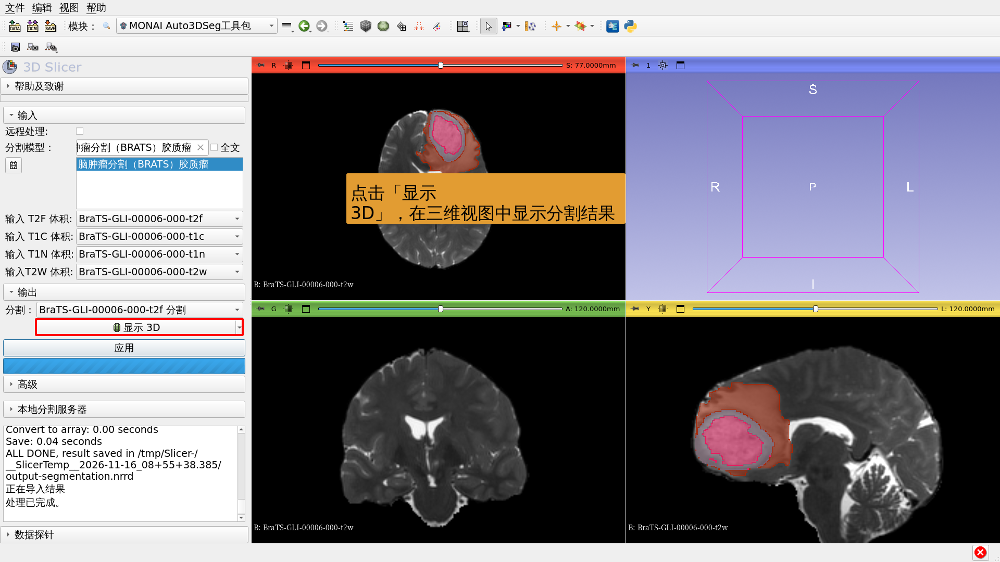

---

# AI 分割任务 3：全身分割

---

##  

使用 AI 进行全身分割。

数据集：

CT_ThoraxAbdomen

---

## 

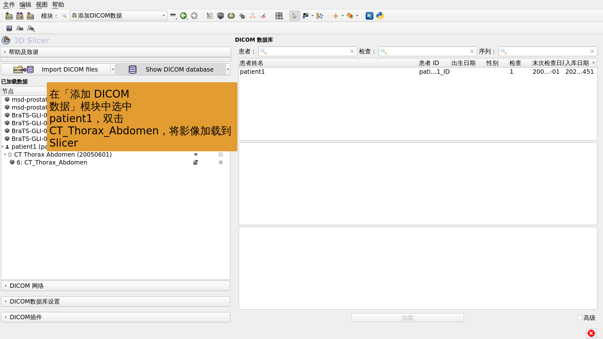

---

## 

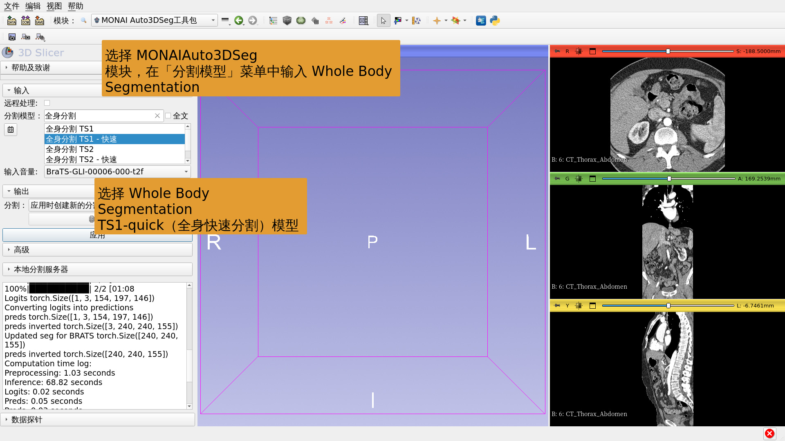

---

## 

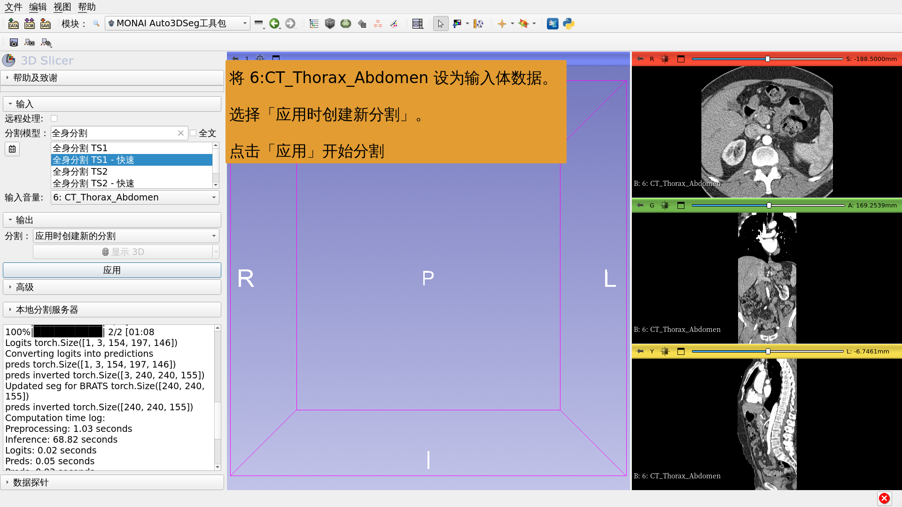

---

## 

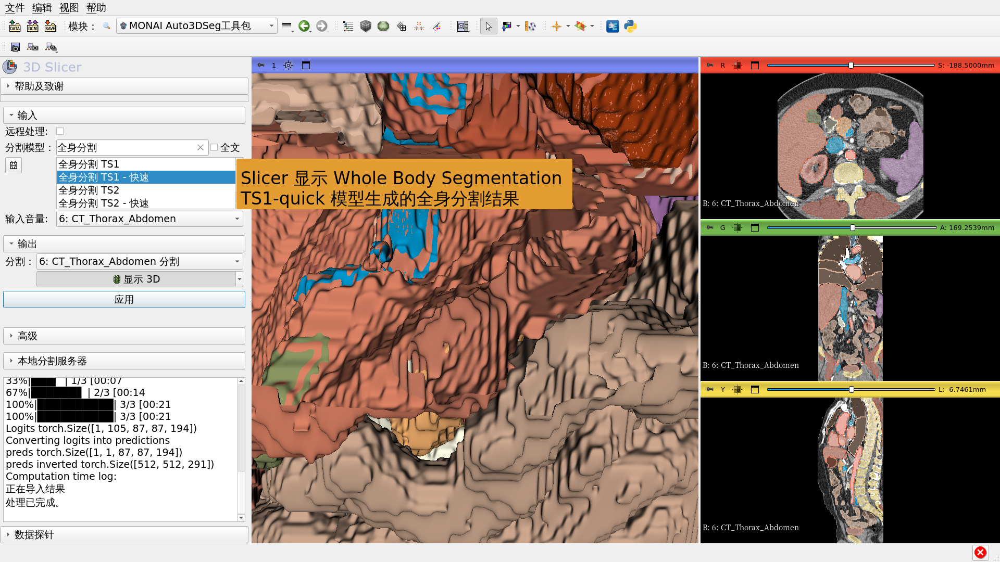

---

## 结论

3D Slicer 的 MONAIAuto3DSeg 扩展可使用 AI 快速分割解剖结构和病变。

此模块可以在没有 GPU 的普通笔记本电脑和台式机上运行。

---

# 致谢

3D Slicer 国际化项目和 3D Slicer 拉丁美洲项目均获得陈－扎克伯格倡议（Chan Zuckerberg Initiative）的资助。

---
